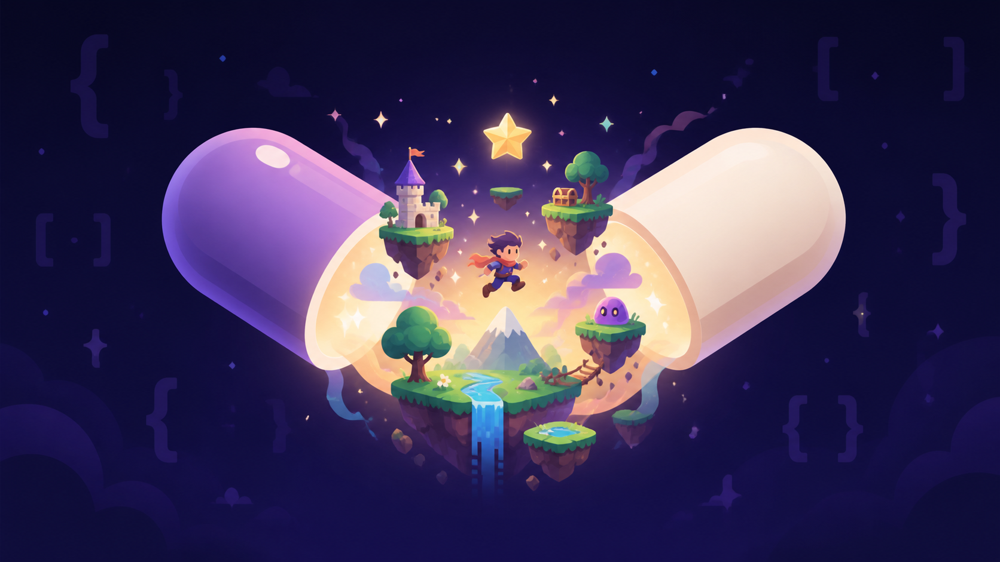

<p align="center">
  
</p>

<h1 align="center">Capsule Engine</h1>

<p align="center">A deterministic, code-first 2D game engine for C#.</p>

Capsule owns the game loop, fixed-step clock, input, rendering, scenes, entities, saves, and build pipeline. Games are authored in C# and in plain scene documents. There is no editor, no project wizard and no serialized scene graph. MonoGame is an internal host dependency and is unavailable to game logic.

Capsule is a good fit for a 2D game that values headless-testable gameplay, explicit code, deterministic stepping, and a small engine surface. It is not a fit for teams that need an integrated editor, 3D, a large plugin ecosystem, or a stable 1.0 API.

## Quick start

Install the .NET SDK selected by [`global.json`](global.json), then run the sample game:

```text
git clone https://github.com/just-awesome-games/capsule-engine.git
cd capsule-engine
dotnet restore --locked-mode
dotnet run --project samples/MinimalGame/src/MinimalGame.Shell
```

[`docs/getting-started.md`](docs/getting-started.md) takes it from there: three projects, a scene, and one entity on screen. Press `` ` `` in any windowed run for the debug overlay ([`docs/debugging.md`](docs/debugging.md)).

## Documentation

Four packages ship, and [`PACKAGE.md`](PACKAGE.md) says what each holds. Every public member's contract is its XML documentation, shipped beside the assemblies. The pages below are the tasks that span many types.

### Start

- [`docs/getting-started.md`](docs/getting-started.md): clone, wire three projects, put one entity on screen, run it.

### Game

- [`docs/entities.md`](docs/entities.md): adding and removing, lifecycle, parenting, pausing, pooling, finding entities.
- [`docs/scenes.md`](docs/scenes.md): scene documents and classes, placing entities, changing scenes.
- [`docs/input.md`](docs/input.md): actions, axes, the pointer, rumble, the cursor, input drivers, the standard command line.
- [`docs/rendering.md`](docs/rendering.md): the canvas, the camera, renderers, draw order, parallax, particles, lighting, text, visibility.
- [`docs/animation.md`](docs/animation.md): sprite animation clips, ticks, events and boxes, tweens, timers and scripted sequences.
- [`docs/ui.md`](docs/ui.md): the screen layer and its UI kit of anchors, containers, labels and focus navigation.
- [`docs/shaders.md`](docs/shaders.md): a shader of your own, its material and its globals.
- [`docs/audio.md`](docs/audio.md): clips, buses, sources, the mixer.
- [`docs/collision.md`](docs/collision.md): which collision piece answers which need, and triggers.
- [`docs/persistence.md`](docs/persistence.md): save documents, writing and reading them, and where they go.
- [`docs/localization.md`](docs/localization.md): string tables, keyed labels, adding a language, switching it.

### Content

- [`docs/assets.md`](docs/assets.md): asset keys, textures, sprite sheets, audio, fonts, shaders, preloading.
- [`docs/configuring-assets.md`](docs/configuring-assets.md): config files, texture settings, atlases, editor completion.

### Build

- [`docs/build-and-publish.md`](docs/build-and-publish.md): project wiring, consuming Capsule, commands, development builds, publishing, build properties.
- [`docs/packages.md`](docs/packages.md): writing a package, the build project, importers, platform modules.
- [`docs/testing.md`](docs/testing.md): testing a game headless at the right boundary.
- [`docs/debugging.md`](docs/debugging.md): the debug overlay, debug draw, panels, logging.

### Reference

- [`docs/architecture.md`](docs/architecture.md): module boundaries, the logic boundary, the determinism contract, the NativeAOT floor.

## Contributing

See [`CONTRIBUTING.md`](CONTRIBUTING.md) for setup and the gate, [`AGENTS.md`](AGENTS.md) for the rules no compiler enforces, [`SECURITY.md`](SECURITY.md) for private vulnerability reporting, and [`CODE_OF_CONDUCT.md`](CODE_OF_CONDUCT.md) for community expectations.

Capsule is licensed under the [MIT License](LICENSE).
Third-party components are listed in the [third-party notices](THIRD-PARTY-NOTICES.md).
